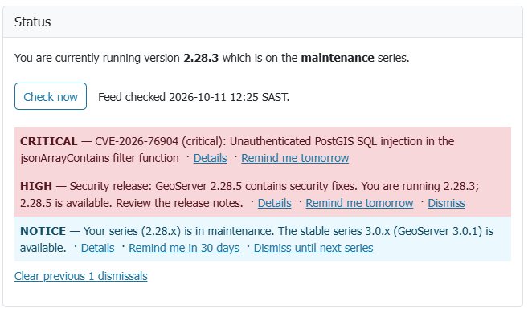
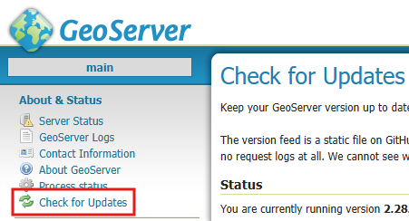
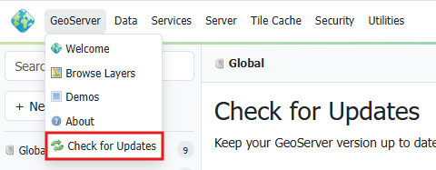

# Check for Updates

The Check for Updates community module tells administrators, on the GeoServer landing page, when the GeoServer they are running
needs attention. It reads a small JSON feed that is published in the GeoServer GitHub repository, and reports:

- a newer patch release in the running series
- that the running series has moved to maintenance, or is no longer supported
- a newer release that the [geoserver.org/blog](https://geoserver.org/blog/) announcement marks as a security release, or that came out together with other
  series, which usually means a security release
- a published security advisory that applies to the running version

The module only ever downloads the feed. It never reports the running version or anything else about the GeoServer it is installed on. The
feed is a static file on GitHub, downloaded from `raw.githubusercontent.com` (see **Feed URL** below for an alternative
host). The GeoServer team does not run these hosts, receives no request logs at all and cannot see which GeoServer
versions are running. The download is an ordinary web request, so the feed host can see the public IP address of the
server making it.



## Installation

As a community module, the package needs to be downloaded from the [nightly
builds](https://build.geoserver.org/geoserver/main/community-latest/) - search for `updates-checker-plugin.zip`.

Unpack the zip file contents into GeoServer's `WEB-INF/lib` directory and restart GeoServer.

!!! note
    The module is compiled for Java 11, so the same JAR can be copied into any GeoServer from version 2.23 onwards, including a server that is already running in production, without rebuilding it.

### Installing with Docker

To run the GeoServer Docker image with the module installed, pass it as a community extension:

{{ release }} example:

```text
docker run -it -p 8080:8080 \
  --env INSTALL_EXTENSIONS=true \
  --env COMMUNITY_EXTENSIONS="updates-checker" \
  docker.osgeo.org/geoserver:{{ release }}
```

## When the feed is checked

The feed is fetched at most once per administrator session, plus once at server startup and whenever **Check Now** or the REST endpoint is used. There is no timer.

- **First view of a session:** the first time an administrator opens the landing page, the page
  loads at once and the feed is fetched in the background. The banner appears in place a moment later.
- **Later views in the same session:** the banner is drawn from what the server already holds, with no new download.
- **Startup:** a short background thread makes one download, so an unreachable feed can never delay server startup.
- A failed download is not retried. The last good copy is kept and used.

Only full administrators (holders of the `ROLE_ADMINISTRATOR` role) see the banner or trigger a download. Workspace administrators and other users do not.

## Configuring

Once installed, the module adds a **Check for Updates** page under the **About & Status** (GeoServer 2) or **GeoServer** (GeoServer 3) menu.

 



Below the Status section are these settings:

- **Feed URL** - where the feed is fetched from. Read-only in the GUI. To use a different feed, for
  example an internal mirror, set the `UPDATES_CHECKER_FEED_URL` [application
  property](../../configuration/properties/index.md) as a Java system property
  (`-DUPDATES_CHECKER_FEED_URL=https://raw.githubusercontent.com/geoserver/geoserver/updates-checker-v1/versions.json`), a web application context parameter, or an
  environment variable. If `raw.githubusercontent.com/` is blocked by your organisation, try the jsDelivr copy of the default feed:
  `https://cdn.jsdelivr.net/gh/geoserver/geoserver@updates-checker-v1/versions.json`.
- **Enable update check at login and startup** - on by default. When off, only **Check Now** and the REST endpoint work.
- **Write check results to logs** - on by default. Writes one line to the GeoServer log for each check (at startup, on
  the first view of a session and on Check Now) with the result and the versions. Failures to
  download or read the feed are always logged at WARN, whatever this setting says.
- **Hide version numbers in logs** - off by default. Leaves version numbers out of
  the per-check result lines. The banner and the Status section always show them, and failure lines are not affected.

The settings are saved in `updates-checker/updates-checker.xml` in the data directory.


## Feed

The feed is automatically built (every 15 minutes) from these free public sources:
* `geoserver/geoserver/security/advisories`
* `geoserver/geoserver/releases`
* `geoserver/geoserver.github.io/_posts`
by the _current https://github.com/petersmythe/gs-updates-checker/tree/alpha workflow.  This will be moved into the GeoServer organisation after the merge of this PR, and preferably into the main `geoserver/geoserver` repo for maintainability._

The feed is published at:
* _https://raw.githubusercontent.com/petersmythe/gs-updates-checker/alpha/versions.json_ (temporarily, until the above feed goes live)
* https://raw.githubusercontent.com/geoserver/geoserver/updates-checker-v1/versions.json
* https://cdn.jsdelivr.net/gh/geoserver/geoserver@updates-checker-v1/versions.json

## Notifications

When several notifications apply, the banner shows the most important one and a link "N more notices" to the Check for Updates page. Order is by severity, and within one
severity security notices come first, then patches, then series notices.

| Notification | Severity | Meaning | Actions |
|---|---|---|---|
| Confirmed security advisory | CRITICAL, HIGH, WARN or INFO, as per the advisory | An advisory applies to the running version | CRITICAL: **Remind me tomorrow**. Others: **Dismiss** |
| Advisory could not be checked | As per the advisory | The advisory's version range could not be read, so it needs a manual look | **Dismiss** |
| Security release | HIGH when announced as a security release, WARN when only released together with other series | A release newer than the running version, in the running series, is a security release or probably one. The notice names that release and the version to upgrade to, and its Details link is the announcement. It replaces the newer patch notice | **Remind me tomorrow**, **Dismiss** |
| Newer patch | WARN | A newer patch exists in the running series | **Remind me tomorrow**, **Dismiss for version X.Y.Z** |
| Series in maintenance | NOTICE | A newer stable series exists | **Remind me in 30 days**, **Dismiss until next series** |
| Series unsupported | WARN | The series is beyond community support, or too old for the feed to cover | none, always shown |
| Feed unavailable | WARN | The feed could not be downloaded and there is no earlier copy | none |
| Feed schema too new | WARN | The feed is newer than this module understands: update the module | none |
| Version unknown | INFO | The running version could not be determined, so no check is made | **Dismiss** (this session) |

The feed names the releases of the last 365 days, so a security release older than that is no longer named; the
advisories still apply.

A SNAPSHOT, release candidate or milestone build is not compared with released versions, and has no advisories or
updates to report. It still reports a feed that is unavailable or too new.

An advisory applies to a version unless that version is at or beyond the first patched version of its own series. An
advisory whose version range cannot be read is never ignored; it is shown for manual review instead.

## Dismissing notifications

Dismissals are stored in the administrator's own browser (`localStorage`), not on the server. A dismissal stops applying as soon as a newer version, series or advisory is involved, so
it never silently hides a later one. A CRITICAL confirmed advisory can only be snoozed for a day, never dismissed for
good.

Because the choice lives in the browser, it applies to that browser and that address only: an administrator on another
device, under another host name, or in a private window sees the notifications again.

## Status and Check Now

The **Status** section on this page shows what GeoServer version is running, when the feed was last checked, and every active
notification. It is filled from the server's copy when the page opens. The notifications have the same actions as the Welcome page
banner, and the ones dismissed in this browser are hidden. The link "Clear previous N dismissals" at the bottom brings
them back.

**Check Now** downloads the feed straight away and refreshes the Status section.


## REST endpoint

`POST /rest/updates-checker/check` performs the same check as **Check Now** (so it downloads the feed every time) and returns the result as JSON:

```json
{
  "status": "URGENT_UPDATE_AVAILABLE",
  "message": "CVE-2026-76904 (critical): Unauthenticated PostGIS SQL injection",
  "installedVersion": "2.27.0",
  "newerVersion": "2.27.6",
  "error": null,
  "notifications": [
    {
      "type": "CVE_CONFIRMED",
      "severity": "CRITICAL",
      "message": "CVE-2026-76904 (critical): Unauthenticated PostGIS SQL injection",
      "discriminator": "GHSA-jvpx-6qxg-whgc",
      "link": "https://github.com/geoserver/geoserver/security/advisories/GHSA-jvpx-6qxg-whgc"
    }
  ]
}
```

`status` is one of:

| Status | Meaning |
|---|---|
| `URGENT_UPDATE_AVAILABLE` | A critical or high security advisory applies to this version or could not be ruled out, or a newer release is a security release |
| `UPDATE_AVAILABLE` | Any other advisory, a newer patch, or a series beyond community support |
| `UP_TO_DATE` | Nothing needs action. A series in maintenance, or a development build, still reports this |
| `CHECK_FAILED` | The check could not tell: the feed could not be read, its schema is newer than the module understands, or the running version is unknown |

`message` is the most important notification, and `notifications` lists everything active, most important first. Access is controlled by GeoServer's standard `/rest`
rules in `security/rest.properties`, which by default require the administrator role (`ROLE_ADMINISTRATOR`). Only `POST` is
accepted, and the response is always JSON.

## Support

This module is maintained by GeoGuru.Africa. Questions, enhancements and issues can be sent to
[gs-updates-checker@geoguru.africa](mailto:gs-updates-checker@geoguru.africa).
