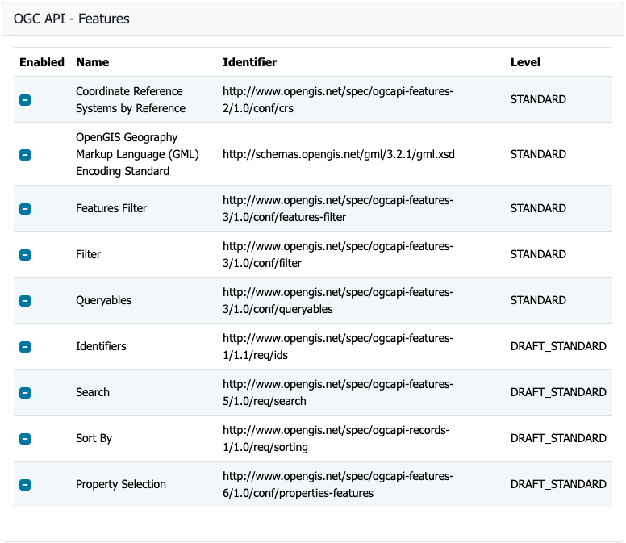
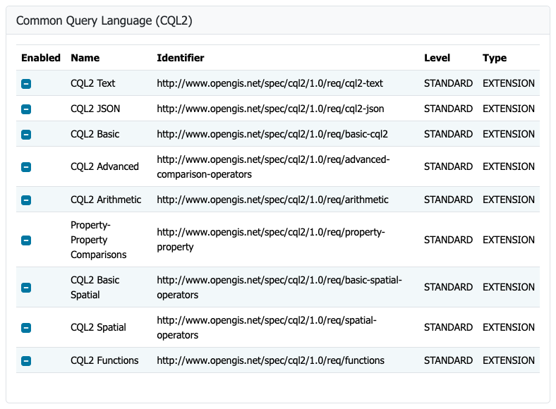
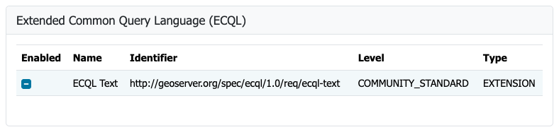

# Configuration of OGC API - Features module

The service operates as an additional protocol for sharing vector data alongside Web Feature Service.

## Service configuration

The service is configured using:

- The existing [Web Feature Service (WFS)](../wfs/index.md) settings to define title, abstract, and output formats.

  This is why the service page is titled `GeoServer Web Feature Service` by default.

- Contact information defined in [Contact Information](../../configuration/contact.md).

- Extra links can be added on a per-service or per-collection basis as indicated in [OGC API Service Configuration](../../configuration/ogc-api-services/index.md).

## Feature Service conformances

The OGC API Feature Service is modular, allowing you to enable/disable the functionality you wish to include.

- By default stable Standards and Community Standards are enabled. If WFS is strict, only official Standards are enabled and community standards are disabled.

- The OpenAPI service description is mandatory and may not be disabled.

- The HTML and GeoJSON output formats are built-in and may not be disabled.

- Mandatory conformance classes are not included in the conformance table, as they cannot be configured.

- OGC API Feature conformances.

  Disabling a class removes it from the `conformance` document. What else changes depends on the kind of class:
  some manage the contents of the API document, while others add resources or request parameters to the service.

  **Standard**:

  - `crsByReference`: when disabled, the `filter-crs` parameter is removed from the API document, and a `crs`
    parameter is ignored, returning features in `EPSG:4326`.

  - `gml321`: when disabled, GML 3.2.1 output is no longer advertised in the API document.

  - `queryables`: when disabled, the queryables resource is removed from the API document.

  - `filter`: when disabled, the `filter` and `filter-lang` parameters are removed from the API document.

  **Draft standard**, disabled by default:

  - `ids`, `sortBy` and `propertySelection`: when enabled, the `ids`, `sortby`, `properties` and
    `exclude-properties` parameters are added to the API document and used when handling a request. When disabled,
    they are not included in the API document, and are ignored if used.

  - `search`: when enabled, the `/search` resource is listed in the API document. When disabled, it is not listed
    and answers with a `404` status.

  

  *Feature Service Configuration*

- CQL2 Filter conformances.

  Both the Text and JSON formats for CQL2 are available and may be enabled or disabled.

  The CQL2 capabilities implemented by GeoServer (basic, advanced comparison, arithmetic, property-property, and
  spatial operators) are built-in, and included in the `conformance` document when CQL2 Text or CQL2 JSON is
  enabled.

  CQL2 Functions provides the `/functions` resource, listing the functions available for use in a filter.

  

  *CQL2 Filter configuration*

- Control of ECQL Filter conformances

  

  *ECQL Filter configuration*

For more information see [Status](status.md).
